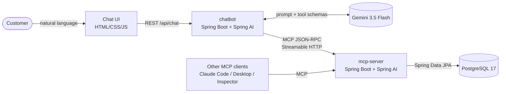

# MercaExpress: grocery delivery chatbot over MCP

A web chatbot that takes supermarket home-delivery orders in natural language. The chatbot does not access the database. Every catalog, customer and order operation goes through a **Model Context Protocol (MCP) server**, which exposes those operations as tools over **Streamable HTTP**. Because of that, any MCP client can use the same tools: this chatbot, Claude Code, Claude Desktop or MCP Inspector.

Built for *Laboratorio 3, Arquitectura de Software* (Universidad de Antioquia, 2026).

## Architecture



| Module | Responsibility | Stack | Port |
|---|---|---|---|
| `mcp-server` | Business rules plus MCP tools for the catalog, customers and orders | Spring Boot 3.5.16, Spring AI 1.1.8 (`spring-ai-starter-mcp-server-webmvc`), Spring Data JPA, Flyway, PostgreSQL | 8088, endpoint `/mcp` |
| `chatbot` | Conversational client: LLM, MCP client, chat memory and web UI | Spring Boot 3.5.16, Spring AI 1.1.8 (`spring-ai-starter-model-google-genai`, `spring-ai-starter-mcp-client`) | 8080 |
| `compose.yaml` | Database | PostgreSQL 17 (Podman or Docker) | 5433 |

The server is organized by feature (`catalog`, `customers`, `orders`). The `mcp` package is a thin inbound adapter: each `@Tool` method delegates to an application service and returns a DTO. All business rules (stock, minimum order, delivery fee, ownership checks) live in the domain and are enforced on the server, never trusted to the model.

### How a message flows

1. The chatbot's MCP client runs the `initialize` handshake at startup and discovers the tools with `tools/list`.
2. The browser sends the user message to `POST /api/chat` with its conversation id.
3. Spring AI sends the prompt, the conversation memory and the tool schemas to Gemini.
4. Gemini answers with tool calls, for example `searchProducts{"query":"leche"}`.
5. The chatbot runs each call against the server with `tools/call`.
6. The server dispatches the call to the `@Tool` method, which reads or writes PostgreSQL and returns JSON (or an error result).
7. The results return to Gemini, which writes the final answer. The UI shows the answer plus the tools that were called.

When a tool fails (for example, an unknown phone or a quantity above the limit), the server returns an MCP error result. The chatbot converts it into a JSON `{"error": "..."}` function response through a custom `ToolExecutionExceptionProcessor`. The Gemini connector requires JSON function responses, and the default plain-text error would abort the whole conversation.

## MCP tools

| Tool | Purpose |
|---|---|
| `listCategories` | Product categories |
| `searchProducts` | Accent-insensitive search by name, description or category, with an optional category filter |
| `getProduct` | Product details by SKU |
| `findCustomerByPhone` | Look up a customer by mobile phone |
| `registerCustomer` | Register a customer with a delivery address |
| `createOrder` | Open (or reuse) the customer's draft order |
| `addItemToOrder` | Add units of a product, checking stock (1 to 50 per product) |
| `removeItemFromOrder` | Remove a product line |
| `getOrder` | Order summary: lines, subtotal, delivery fee, total, notes |
| `confirmOrder` | Confirm a draft with a payment method and reserve stock under a pessimistic lock |
| `cancelOrder` | Cancel a draft or confirmed order, restoring stock |
| `listCustomerOrders` | The 10 most recent orders |

Business rules: minimum subtotal COP 20,000; delivery fee COP 7,000, free from COP 150,000; payment is cash or card on delivery; an order can only be read or changed with its owner's phone.

## Quick start

Requirements: Java 21, Podman or Docker, and a free [Gemini API key](https://aistudio.google.com/apikey).

```bash
# 1. Database (Flyway creates the schema and seed data on server startup)
podman compose up -d          # or: docker compose up -d

# 2. MCP server
./mcp-server/mvnw -f mcp-server/pom.xml spring-boot:run

# 3. Chatbot (in another terminal; the MCP server must already be running)
export GEMINI_API_KEY=your-key
./chatbot/mvnw -f chatbot/pom.xml spring-boot:run

# 4. Open http://localhost:8080
```

Demo customers: `3001234567` (Laura Gómez) and `3109876543` (Carlos Restrepo). You can also register a new customer in the chat.

Configuration through environment variables (see `.env.example`): `GEMINI_API_KEY`, `GEMINI_MODEL` (default `gemini-3.5-flash`), `MCP_SERVER_URL` (default `http://localhost:8088`), `DB_URL`, `DB_USER`, `DB_PASSWORD`.

`gemini-2.5-flash` is no longer available to new API keys (it returns 404). Use `GEMINI_MODEL` to switch models without code changes. On the free tier, a single message can trigger several model calls, so bursts may hit the per-minute quota (HTTP 429). The UI then shows a "Try again" button.

## Verify the MCP server without the chatbot

```bash
# Handshake
curl -X POST http://localhost:8088/mcp \
  -H "Content-Type: application/json" -H "Accept: application/json, text/event-stream" \
  -d '{"jsonrpc":"2.0","id":1,"method":"initialize","params":{"protocolVersion":"2025-03-26","capabilities":{},"clientInfo":{"name":"curl","version":"1.0"}}}'

# List and call tools with MCP Inspector (CLI mode)
npx @modelcontextprotocol/inspector@0.17.2 --cli http://localhost:8088/mcp --transport http --method tools/list
npx @modelcontextprotocol/inspector@0.17.2 --cli http://localhost:8088/mcp --transport http \
  --method tools/call --tool-name searchProducts --tool-arg query=cafe

# Or the Inspector web UI (choose "Streamable HTTP" and http://localhost:8088/mcp)
npx @modelcontextprotocol/inspector@0.17.2
```

## Use the same server from other MCP clients

```bash
# Claude Code
claude mcp add --transport http supermarket http://localhost:8088/mcp
```

Claude Desktop (via the `mcp-remote` STDIO-to-HTTP bridge) in `claude_desktop_config.json`:

```json
{
  "mcpServers": {
    "supermarket": {
      "command": "npx",
      "args": ["-y", "mcp-remote", "http://localhost:8088/mcp"]
    }
  }
}
```

## Tests

```bash
./mcp-server/mvnw -f mcp-server/pom.xml verify   # needs Docker/Podman for Testcontainers
./chatbot/mvnw -f chatbot/pom.xml verify
```

- `mcp-server`: domain rule tests, phone normalization tests, and an end-to-end MCP test. That test starts the server on a random port against a PostgreSQL Testcontainer and drives it with the MCP Java SDK client (`initialize`, `tools/list`, an order placed and cancelled with stock checks, error results).
- `chatbot`: controller tests (reply, validation, upstream failures) and the tool-call recorder.

With Podman, export `DOCKER_HOST=unix:///run/user/$(id -u)/podman/podman.sock` and `TESTCONTAINERS_RYUK_DISABLED=true` before running the server tests.

## Security notes

The MCP endpoint has **no authentication**. Anyone who can reach port 8088 can call every tool, including the ones that change data. Keep it bound to localhost. Before exposing it, add OAuth 2.1 or API-key authentication, TLS, rate limiting and per-customer authorization (the phone check identifies a customer, it does not authenticate them). Secrets come only from environment variables. The Gemini key and the database password are never committed.
